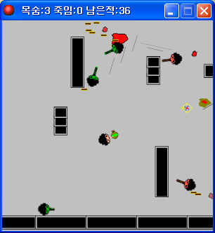

# 전쟁시대

장애물이 깔린 아레나에서 몰려오는 적 팀과 싸우는 탑다운 전투 게임이다. 게임메이커 커뮤니티 이벤트에 내려고 만들었다.

  

## 플레이 방법

Releases에서 받아 실행하면 된다.

WASD로 움직이고 마우스로 조준한다. 1, 2, 3 키로 무기를 바꿔 든다.

| 키 | 무기 |
|---|---|
| 1 | 권총 (50 데미지) |
| 2 | 기관총 (10 데미지) |
| 3 | 수류탄 |

남은 목숨과 처치 수, 남은 적 수는 창 제목표시줄에 나온다.

## 구현 원리

적 유닛의 박격포는 잔상과 폭발 연출을 조합해 만들었다. 포탄이 날아가는 동안 알람으로 포탄 뒤에 그림자 오브젝트를 계속 떨어뜨려 잔상을 만든다. 떨어뜨린 그림자는 자기 알람으로 `image_alpha` 를 0.5씩 깎다가 0 아래로 내려가면 스스로 사라진다. 착탄하면 그 자리에 폭발 하나를 만들고, 이어서 `choose(20,25,30,35)` 로 뽑은 좌표에 폭발을 다섯 개 더 흩뿌린다. 매번 터지는 모양이 달라진다.

## 파일

| 경로 | 내용 |
|---|---|
| `source/age-of-war.gmk` | 원본 프로젝트 파일 |
| `source/split/` | GmkSplitter로 분해한 텍스트 트리 |
| `docs/screenshots/` | 스크린샷 |
| Releases | 배포용 파일 |

## 라이선스

CC BY-NC-ND 4.0 라이선스다. 출처를 밝히면 비상업 용도로 그대로 공유할 수 있고, 수정본 배포와 상업적 이용은 금지한다. 함께 들어 있는 것 중 다른 사람이 만든 라이브러리와 그림·소리·맵은 각자의 권리를 따른다. 자세한 내용은 [LICENSE](LICENSE) 에 있다.
